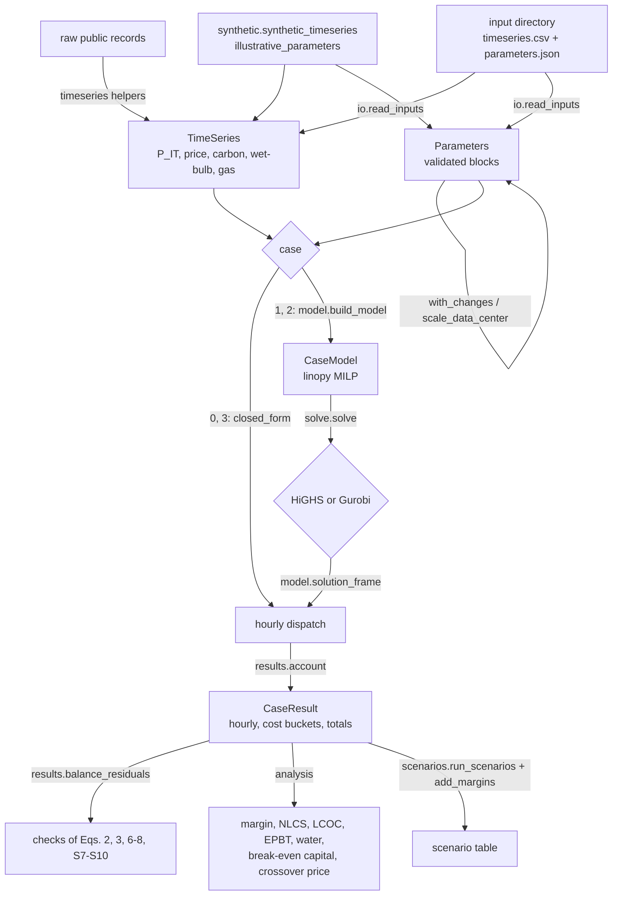

# Software architecture

## Data flow

## Modules (`src/smr_dc_cogen/`)

| Module | Content |
|---|---|
| `parameters.py` | parameter blocks (`Site`, `Finance`, `Grid`, `Chiller`, `Reactor`, `Turbine`, `Outage`, `Absorber`, `Battery`, `GasPlant`) with units in the field names and validation; `Parameters` with derived quantities (net rating, thermal fuel price); finance relations (CRF, annuity factor, salvage credit, Eq. 12); PUE–COP conversion; extraction penalty from a heat balance; `with_changes`, `to_dict`, `from_dict` |
| `timeseries.py` | `TimeSeries` (aligned hourly inputs, annualization weight, windows, load scaling) and the preparation helpers of [data_pipeline.md](data_pipeline.md) |
| `physics.py` | Eq. (1), Eqs. (4)–(5), the VCC relief multiplier and part-load map $`f_\mathrm{v}`$, the NGCC multiplier $`\phi_\mathrm{ng}`$, the outage mask |
| `cases.py` | the four configurations (`CASES`), required blocks, asset sizes, dispatch-neutral capital and fixed O&M per asset |
| `closed_form.py` | Cases 0 and 3 |
| `model.py` | `build_model`: the MILP of Cases 1 and 2 (and Case 0 for checking), constraints named by equation number; `solution_frame` |
| `solve.py` | `solve` (HiGHS default, Gurobi optional; raises `SolveError` unless optimal), `result_of`, `run_case` |
| `results.py` | `CaseResult`, `account` (cost buckets of Eq. 9 and annual totals from hourly dispatch, the same for every case), `balance_residuals`, `cost_table`, `bucket_difference`, strict JSON output |
| `analysis.py` | grid-cost margin (Eq. 13), secondary endpoints (Eqs. S1–S6), realized PUE, break-even capital, crossover price, extraction diagnostics |
| `scenarios.py` | `Scenario`, `run_scenarios`, `add_margins`, the size rule `scale_data_center` |
| `synthetic.py` | synthetic series and illustrative parameters and endpoint factors |
| `io.py` | read and write the input directory |
| `cli.py` | the `smr-dc-cogen` command: `synthetic` and `run` |

## Model structure

- **Dimensions:** `t` (hour) and `k` (segment of the chiller map).
- **Variables per hour:** reactor $`P_\mathrm{rx}`$, $`P_\mathrm{tg}`$, $`P_\mathrm{tn}`$; for Case 2, $`Q_\mathrm{ext}`$ and $`Q_\mathrm{a}`$; chiller $`Q_\mathrm{v}`$, $`P_\mathrm{v}`$ and the segment fractions $`\delta_k`$; grid import and export; the interlock binary $`y`$; for the battery, $`B^{+}`$, $`B^{-}`$ and $`E_\mathrm{B}`$.
- **Outage hours** are fixed through variable bounds ($`P_\mathrm{rx}`$, $`P_\mathrm{tg}`$ and $`Q_\mathrm{ext}`$ have upper bound zero), which the solver's presolve removes.
- **Ramp and state-of-charge links** between consecutive hours use a cyclic shift of the hour index, masked so that only valid pairs are constrained.
- **Constraint names** carry the equation number: `eq2_willans`, `eq3_auxiliary`, `eq6_absorber_yield`, `eq7_import`, `eq7_export`, `eq8_electric_balance`, `cooling_balance`, `S9_ramp_up`, `S9_ramp_down`, `S10_soc`, `S10_soc_first`, `S10_cyclic_end`, `vcc_load`, `vcc_power`, `vcc_order_next`, `vcc_order_this`.
- **Objective:** the dispatch-dependent part of Eq. (9). Capital and fixed O&M are held in `CaseModel.fixed_cost`.

## Solvers

- **HiGHS** (default, open source, installed with `highspy`): solves the examples in well under a second per case, and a full synthetic year in seconds to minutes (see below).
- **Gurobi** (optional): `pip install gurobipy` plus a licence, then `run_case(..., solver="gurobi")`. The article solved its runs with Gurobi.
- **Options** go in a mapping that overrides the defaults, for example `{"time_limit": 3600, "mip_rel_gap": 1e-4}` for HiGHS or `{"Threads": 8}` for Gurobi.

## Problem size

For $`\lvert\mathcal{T}\rvert`$ hours and a chiller map with $`K`$ segments, a Case 2 instance has about

- $`(10 + 2K)\,\lvert\mathcal{T}\rvert`$ variables, of which $`(K + 1)\,\lvert\mathcal{T}\rvert`$ are binary: one interlock binary and $`K`$ ordering binaries per hour, one of which is fixed to zero;
- a similar number of constraints;
- with the battery, $`3\,\lvert\mathcal{T}\rvert`$ more variables and $`\lvert\mathcal{T}\rvert`$ more constraints.

Case 1 has no $`Q_\mathrm{ext}`$ and no $`Q_\mathrm{a}`$, so two fewer variables per hour.

Measured on a laptop (Apple silicon) with the synthetic full year (`synthetic_timeseries(hours=8760, start_day=0)`, illustrative parameters, $`K = 5`$, no battery):

| Case | Variables | Constraints | Binaries | Build | HiGHS 1.15 | Gurobi |
|---|---|---|---|---|---|---|
| 1 | 157,680 | 165,122 | 52,560 | 0.3 s | 17 s | < 1 s |
| 2 | 175,200 | 173,882 | 52,560 | 0.1 s | 7 s | < 1 s |

Solve times depend strongly on the price series and the parameters: hours in which the chiller map's non-convex segments matter, and many near-indifferent hours, make the branch and bound longer. Set a time limit for exploratory runs, and report the solver and gap used.

## Output tables

`CaseResult.hourly` has one row per hour with these columns (zero where a block is absent):

| Column | Unit |
|---|---|
| `it_load_mw`, `cooling_demand_mwc` | MW_e, MW_c |
| `reactor_mwth`, `turbine_gross_mw`, `turbine_net_mw`, `extraction_mwth` | MW |
| `absorber_mwc`, `absorber_cop`, `absorber_available`, `absorber_parasitic_mw` | MW_c, –, –, MW_e |
| `chiller_mwc`, `chiller_mw` | MW_c, MW_e |
| `grid_import_mw`, `grid_export_mw` | MW_e |
| `battery_charge_mw`, `battery_discharge_mw`, `battery_soc_mwh` | MW, MW, MWh |
| `gas_plant_mw`, `gas_heat_rate_multiplier`, `gas_delivered_usd_per_mmbtu` | MW_e, –, $/MMBtu |
| `price_usd_per_mwh`, `carbon_g_per_kwh`, `wet_bulb_c`, `outage` | inputs, and the outage flag |

`CaseResult.costs` holds the signed contributions to TAC in $/yr: `capex`, `fom`, `vom`, `fuel`, `grid` (negative for net export revenue), `carbon`, `ptc` (negative: a credit) and `tac`.

For Cases 1 and 2, `CaseResult.solver` holds the solver name and version, status and termination condition, the requested relative MIP gap, the gap the solver reports (None if not available) and the objective plus fixed costs.

`CaseResult.totals` holds annual quantities:

- energies: IT, cooling, absorber and chiller cooling, chiller and parasitic electricity, reactor heat, extraction, net generation, imports and exports, battery throughput;
- the absorber's share of cooling;
- the net footprint (t CO₂);
- the levelized credit;
- the number of hours with simultaneous battery charge and discharge.

`smr-dc-cogen run DIR --out-dir OUT` writes:

- `costs.csv`: buckets by case, in million $/yr;
- `summary.json`: per case, the buckets and the margin against Case 0, in strict JSON;
- per case, `summary_case<N>.json` with every scalar result and `hourly_case<N>.csv`.

## Tests (`tests/`)

| File | What is tested |
|---|---|
| `test_parameters.py` | CRF, annuity factor and Eq. (12) against hand formulas; salvage convention; PUE–COP inverse; heat-balance penalty; outage from the capacity factor; derived reactor quantities; rejection of invalid values, unknown keys and unset blocks; changes applied together; dictionary round trip |
| `test_physics_and_series.py` | Eqs. (1), (4), (5); relief multiplier; chiller breakpoints and evaluation, non-convexity of the example map; NGCC multiplier; outage mask; preparation helpers (leap-year trim, weekday alignment, hourly means, daily-to-hourly fill, Stull wet-bulb reference value, average carbon intensity, Willans fit through the design point); series validation and CSV round trip |
| `test_cases.py` | Cases 0 and 3 against hand-computed buckets (Eqs. 10, 11, S11, S13, S14); capacity errors; annualization weight; Case 0 MILP equals the closed form; Cases 1 and 2 satisfy every balance (residuals recomputed from the solution), outage and gate rules, and the accounted TAC equals the solver objective; price-sign response of the absorber; Eq. (2) with extraction; binding ramp limit; interlock and exports; grid purchases during the outage; battery arbitrage and end state; carbon and credit accounting; concavity of TAC in the carbon price; optional Gurobi–HiGHS agreement (skipped without `gurobipy`) |
| `test_analysis.py` | Eq. (13); Eqs. (S1)–(S6) and realized PUE; break-even formula; the absorber's break-even capital closes the Case 2 – Case 1 gap when re-solved; reactor parity capital closes the gap to Case 0; crossover interpolation and upward extrapolation; extraction diagnostics; size rule; scenario runs and matched margins |
| `test_io_cli.py` | input-directory round trip and error messages; command line `synthetic` and `run` with strict-JSON outputs; battery option; exit codes; `python -m smr_dc_cogen` |
